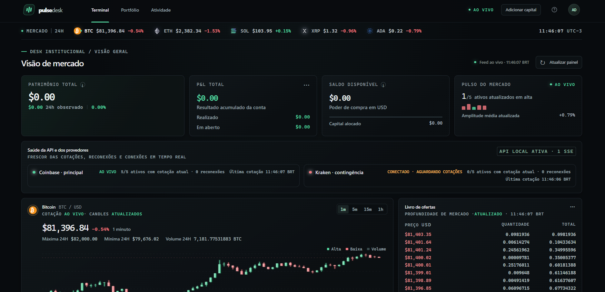

# Pulse Desk

Aplicação web para acompanhar cotações públicas de criptoativos, analisar uma carteira configurada manualmente e simular operações sem enviar ordens a corretoras.



*Captura real da interface. Valores e horários correspondem ao instante em que a imagem foi registrada.*

## Aplicação

O frontend usa Angular 22 e TypeScript. Ele é publicado como site estático no GitHub Pages. As cotações chegam diretamente ao navegador por conexões públicas WebSocket da Coinbase Advanced Trade e da Kraken Spot; não há uma API Pulse Desk hospedada no caminho dos dados.

A interface acompanha BTC, ETH, SOL, XRP e ADA contra USD. Se um feed cair ou ficar desatualizado, o navegador tenta reconectar e mostra o estado recebido. A disponibilidade das corretoras e da conexão de internet não é garantida pelo Pulse Desk.

### Mercado e visualização

* Cotações, variações e volume recebidos dos feeds públicos.
* Livro de ofertas, candles recentes e negócios públicos quando o canal da Coinbase os disponibiliza.
* Kraken como fonte alternativa de cotações.
* Mapa de ativos com correlações estatísticas e classificação adaptativa local de regimes de mercado.
* A classificação K-means e as correlações são cálculos no navegador. O projeto não conecta agentes autônomos nem um serviço externo de IA.

### Carteira e paper trading

* Capital, posições, ordens e execuções começam zerados. Informe manualmente o capital antes de criar ordens.
* Ordens são simuladas no navegador e nunca são transmitidas a uma corretora.
* A simulação usa os níveis públicos atuais do livro da Coinbase, aplica taxa estimada de 0,10% e registra preenchimentos parciais de ordens limitadas.
* Resultado não realizado usa a cotação atual. O retorno de 24 horas só aparece depois que o navegador mantém uma janela suficiente de amostras.
* Perfil e conta paper ficam no armazenamento deste navegador. Eles não são enviados ao GitHub Pages nem sincronizados com outro navegador ou dispositivo.
* Use **Perfil → Cópia de segurança** para exportar um arquivo JSON e guarde-o fora do navegador. Limpar os dados do site ou perder o acesso a este navegador pode apagar a conta local; importe o backup para restaurá-la.

O saldo é uma simulação para estudo, não um saldo de corretora. Preços públicos podem atrasar ou ficar indisponíveis, e resultados simulados não representam execuções garantidas.

## Publicação gratuita no GitHub Pages

O GitHub Pages hospeda arquivos estáticos; ele não executa o servidor Node.js. A versão publicada recebe os feeds no navegador e mantém os dados da conta localmente. A documentação do Pages descreve essa hospedagem estática em [GitHub Pages](https://docs.github.com/en/pages/getting-started-with-github-pages/what-is-github-pages).

O workflow [pages.yml](.github/workflows/pages.yml) compila o Angular para o caminho do repositório, prepara o fallback das rotas e publica o artefato quando há um push para `main`.

1. No repositório `Diogokranzz/PulseDesk`, abra **Settings → Pages**.
2. Em **Build and deployment**, escolha **GitHub Actions** como fonte.
3. Envie o workflow e as alterações para `main`. Acompanhe o resultado na aba **Actions**.

Depois da primeira publicação, o endereço esperado é [https://diogokranzz.github.io/PulseDesk/](https://diogokranzz.github.io/PulseDesk/).

## Executar no computador

Requisitos: Node.js `^22.22.3`, `^24.15.0` ou `>=26` e npm.

No PowerShell, na pasta do projeto:

```powershell
npm.cmd install
npm.cmd start
```

Abra `http://localhost:4200`. O Angular roda a interface e o navegador conecta diretamente aos provedores públicos. Para gerar os arquivos de publicação:

```powershell
npm.cmd run build
```

O artefato do Pages é gerado em `dist/pulsedesk/browser`. Para compilar localmente com a mesma base do Pages:

```powershell
npm.cmd run build -- --base-href /PulseDesk/
```

## Dados locais e backups

O saldo inicial exige entrada manual. O navegador armazena a conta paper e a curva patrimonial em `localStorage`; o perfil e as preferências também permanecem no navegador. O arquivo de backup exportado inclui o perfil e os dados da simulação, mas não contém cotações públicas.

O backup não é sincronização automática. Exporte uma nova cópia depois de operações importantes e mantenha-a em um local seguro. A aplicação não recebe senha de corretora, chave de API ou credencial financeira.

## Estrutura

```text
frontend/src/app/
  core/                 feed direto, estado local, tipos e modelo de regimes
  pages/                terminal, portfólio e atividade
  shared/               gráficos, mapa, risco, alertas, replay e tabelas
public/                 favicon e logos dos ativos
docs/images/            captura real exibida neste README
.github/workflows/      publicação automática no GitHub Pages
src/                    API Node local mantida separada do frontend publicado
```
