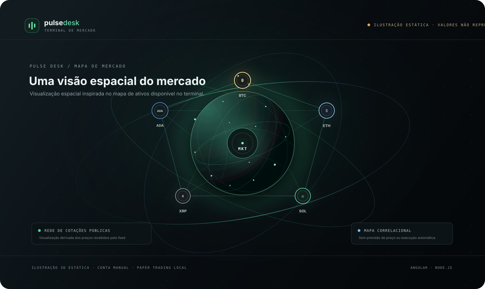
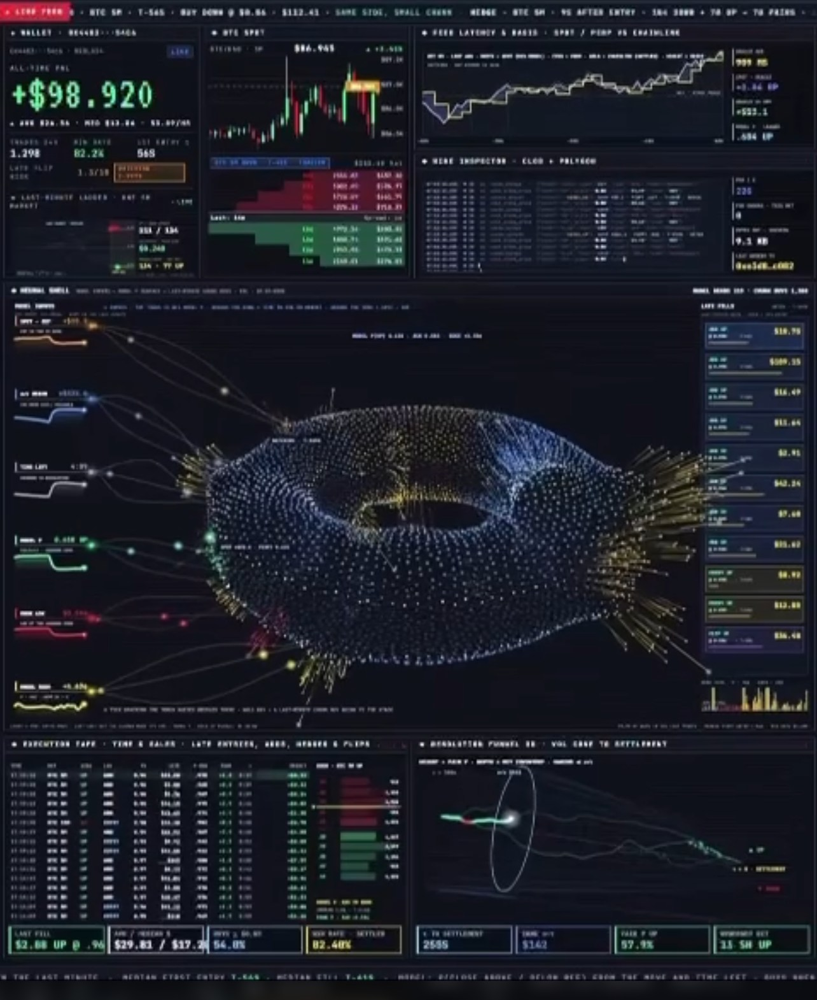
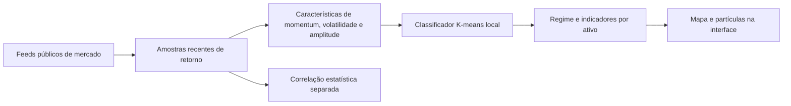

# Pulse Desk

Terminal local para acompanhar cotações públicas de criptoativos, analisar uma carteira informada manualmente e simular operações sem transmitir ordens a uma corretora.



A arte orbital é uma ilustração SVG estática para apresentar a identidade visual. A animação do terminal é renderizada pela aplicação e acompanha o estado dos dados recebidos. Preços, variações, correlações, sinais e património são calculados ou recebidos em tempo de execução; os elementos decorativos da imagem não são dados financeiros.



## Produto

O frontend usa Angular 22, TypeScript estrito, componentes standalone e estado reativo. A API é executada em Node.js, mantém a conta local e conecta-se a provedores públicos de mercado.

O terminal acompanha BTC, ETH, SOL, XRP e ADA contra USD. A aplicação não cria saldo inicial. A pessoa usuária configura o capital manualmente antes de operar. Ordens são simulações locais e nunca são enviadas à Coinbase ou à Kraken.

## Recursos

### Mercado

* Cotações, variação e volume público em tempo real.
* Coinbase Advanced Trade como fonte principal e Kraken Spot como contingência de cotações.
* Candles, livro de ofertas Level 2 e negócios públicos recebidos da Coinbase.
* Estado e horário de cada fonte, idade das leituras e sinalização de dados desatualizados.
* Interface de terminal, carteira e atividade, com logo dos ativos e painel detalhado por moeda.

### Modelo de aprendizado de máquina no mapa

O backend executa localmente um classificador adaptativo K-means sobre retornos recentes dos cinco ativos. Não há integração com um LLM, serviço externo, chave de API ou cobrança, e os dados da carteira não são enviados para análise. O modelo observa janelas de retornos e calcula momentum, volatilidade e proporção de retornos positivos. Depois de reunir amostras suficientes, agrupa essas observações em três regimes e classifica cada ativo como momentum positivo, negativo ou lateral.

O backend atualiza as amostras quando chegam novas cotações e limita a frequência de novos agrupamentos depois que o modelo está calibrado. A interface recebe o regime, a volatilidade observada, a quantidade de amostras e um indicador de proximidade ao cluster escolhido. Esse indicador não é uma probabilidade calibrada nem uma medida de chance de acerto.

O mapa usa esses resultados para colorir os ativos e conduzir a sequência visual de partículas. As partículas e a animação 3D simulada são renderização de interface: não são agentes autônomos, processamento quântico ou atividade de satélite. A inferência é descritiva; não prevê preços, recomenda investimentos nem envia ordens. Ela pode ser desligada definindo `PULSEDESK_AI=0` antes de iniciar a API.

As correlações entre ativos são cálculos estatísticos separados e não entram nas características do classificador.



### Finanças e risco

* Património, caixa, posições e P&L começam zerados até o cadastro manual de capital.
* P&L diário compara o património total atual com uma amostra persistida de aproximadamente 24 horas. O resultado inclui a variação das posições abertas e fechadas refletida no património. O painel mostra indisponibilidade até existir uma janela completa.
* Histórico patrimonial persistido localmente por até 26 horas, com amostragem por minuto e recuperação após reiniciar a API.
* Painel com maior concentração, drawdown observado e cenário hipotético de queda de 10% nas posições abertas.
* Leitura explicável da carteira responde perguntas predefinidas com dados calculados localmente. É somente de consulta.

### Paper trading e diário

* Ordens a mercado percorrem os níveis disponíveis do livro Coinbase e são rejeitadas se o livro atual não tiver profundidade para preenchê-las por completo.
* Ordens limitadas podem preencher parcialmente. A quantidade restante continua reservada e pode ser cancelada.
* Taxa simulada de 0,10%, preço médio ponderado, volume, taxas e slippage por execução.
* Prévia da ordem percorre a profundidade atual antes de confirmar uma compra ou venda a mercado.
* Registro opcional de estratégia e tese junto a cada ordem, com volume e taxas agregados por estratégia na atividade.
* Chave de idempotência, serialização das alterações financeiras e diário local de eventos.
* Exportação e restauração versionada da conta de simulação.

O livro usado na simulação é uma fotografia pública e transitória. A simulação não modela fila de prioridade, latência de corretora, impacto real no mercado ou concorrência com outras ordens. Os resultados não representam execução garantida.

### Alertas e replay

* Até 30 alertas locais de preço acima ou abaixo de um limite, mais um limite configurável de perda nas últimas 24 horas.
* Notificações opcionais de novas execuções paper e de transição do feed para estado desatualizado. Limites de frequência reduzem alertas repetidos. Regras e preferências ficam no armazenamento deste navegador.
* Replay somente de leitura com cruzamento de médias sobre candles públicos de um minuto.
* O replay usa o sinal de candle encerrado e assume entrada na abertura do candle seguinte para reduzir viés de antecipação.
* Taxa de 0,10% por execução, slippage configurável, drawdown máximo e comparação com comprar e manter.
* O capital teórico do replay é separado da conta e não afeta o saldo ou as posições.

O replay usa o histórico disponível no terminal, atualmente limitado a aproximadamente 350 candles de um minuto por ativo. Taxas, slippage e execução em abertura são hipóteses da simulação, não dados históricos do livro.

### Desempenho da interface

O mapa usa canvas 2D com partículas limitadas, atualização de até 24 quadros por segundo, pausa quando fora da tela ou quando a aba está oculta e respeito à preferência de movimento reduzido do sistema.

## Requisitos e início local

Requisitos: Node.js `^22.22.3`, `^24.15.0` ou `>=26`, npm e acesso à internet para instalar dependências e receber dados públicos. Não é necessária chave de API.

No PowerShell:

```powershell
npm.cmd install
npm.cmd run build
npm.cmd start
```

O comando `start` executa uma compilação de produção e inicia a API local na porta `4173`. Depois, abra `http://localhost:4173`. Para encerrar, use `Ctrl+C`.

Para trabalhar com recarga automática, use dois terminais:

```powershell
npm.cmd run dev:api
```

```powershell
npm.cmd run dev:ui
```

A interface de desenvolvimento fica em `http://localhost:4200` e encaminha `/api` para a API local na porta `4173`.

## Configuração local

* `PORT`: porta HTTP entre 1 e 65535. Padrão `4173`.
* `HOST`: endereço de escuta. Padrão `127.0.0.1`.
* `PULSEDESK_DATA_DIR`: diretório para diário, cache e histórico financeiro. Padrão `data` na raiz do projeto.
* `PULSEDESK_AI`: defina `0` para desligar a inferência K-means local.

PowerShell:

```powershell
$env:PORT = "4180"
$env:HOST = "127.0.0.1"
$env:PULSEDESK_AI = "1"
npm.cmd start
```

O servidor fica restrito à máquina local com o valor padrão de `HOST`. Alterar o endereço para uma interface de rede expõe a API e os dados locais. O projeto ainda não tem autenticação multiusuário e não deve ser publicado ou aberto à rede antes da implementação e revisão de autenticação, autorização, gestão de segredos e persistência apropriada para múltiplas contas.

## Provedores e degradação

Coinbase é a fonte principal e fornece ticker, livro de ofertas, negócios e candles históricos pela [API pública Advanced Trade](https://docs.cdp.coinbase.com/coinbase-app/advanced-trade-apis/websocket/websocket-endpoints). Se as cotações da Coinbase ficarem desatualizadas, Kraken pode fornecer ticker alternativo pelo [canal público Spot WebSocket v2](https://docs.kraken.com/exchange/api-reference/spot-websocket-v2/ticker) para manter preços e análise de mercado atualizados. A interface mostra qual fonte está ativa e a saúde de ambas.

A interface recebe snapshots por Server Sent Events. Se o navegador não receber um evento recente, consulta a API local a cada cinco segundos enquanto tenta restabelecer o fluxo contínuo. A tela mantém as cotações marcadas como atuais somente quando os próprios feeds confirmam leituras recentes.

A Kraken fornece apenas contingência de ticker nesta versão. Ordens paper trading continuam bloqueadas sem preço e livro atuais da Coinbase. Livro, candles e negócios podem ficar indisponíveis durante uma falha da fonte principal, sem derrubar a API local, a carteira ou a conta. Dados recuperados de cache são identificados como desatualizados e não são tratados como cotações atuais.

Endpoints de saúde:

* `GET /api/health/live`: confirma que o processo HTTP responde.
* `GET /api/health/ready`: estado operacional local e degradação do mercado.
* `GET /api/health`: estado dos feeds, canais, horário da última cotação e quantidade de conexões SSE.

## Dados financeiros e persistência

O capital precisa ser adicionado manualmente em USD. Sem capital configurado, a API informa campos financeiros nulos quando aplicável e a interface não presume saldo, posição ou rendimento.

Os seguintes arquivos são criados localmente dentro de `PULSEDESK_DATA_DIR`:

* `ledger.jsonl`: capital, ordens, preenchimentos e cancelamentos da conta paper.
* `market-cache.json`: dados públicos recentes, sempre marcados como desatualizados após recuperação.
* `equity-history.json`: amostras de património para as métricas de 24 horas.

O perfil e os alertas são mantidos no armazenamento local do navegador. Backup financeiro exportado deve ser guardado como dado sensível. Apagar a simulação limpa a conta e o histórico patrimonial, mas não apaga cotações públicas em cache.

## API da conta

* `GET /api/snapshot?symbol=BTCUSD`: estado completo do mercado e da conta.
* `GET /api/stream?symbol=BTCUSD`: snapshots contínuos por Server Sent Events.
* `GET /api/orders`: ordens locais recentes.
* `GET /api/ledger`: execuções, posições, caixa e P&L realizado.
* `GET /api/account/backup`: exporta a conta paper.
* `POST /api/account/capital`: configura capital inicial manual.
* `POST /api/account/reset?symbol=BTCUSD`: limpa a conta paper.
* `POST /api/account/backup`: restaura um backup validado.
* `POST /api/orders`: cria ordem paper a mercado ou limitada.
* `DELETE /api/orders/{id}`: cancela uma ordem aberta.

Ativos aceitos: `BTCUSD`, `ETHUSD`, `SOLUSD`, `XRPUSD` e `ADAUSD`. A API limita corpos JSON, aplica limite de solicitações por origem e envia cabeçalhos de segurança. Esses controles reduzem abuso acidental; não substituem autenticação e autorização antes de exposição externa.

## Organização do projeto

```text
frontend/src/app/
  core/                 contratos de domínio, formatação e serviço de mercado
  pages/                terminal, carteira e atividade
  shared/               mapa, risco, replay, diário, alertas e tabelas
src/
  coinbase-feed.js       WebSocket, REST alternativo e candles Coinbase
  kraken-feed.js         ticker público e reconexão Kraken
  market-regime-model.js inferência adaptativa K-means local
  market.js              cotações, correlações, risco e snapshots
  performance-store.js   persistência do histórico patrimonial
  journal.js             diário local de eventos financeiros
  trading.js             validação e simulação de ordens
  server.js              API HTTP, saúde e fluxo SSE
docs/images/
  pulsedesk-orbital-market.svg ilustração para o README
  referencia_terminal.jpg     captura de referência visual
```

## Uso responsável

O Pulse Desk é uma ferramenta local de estudo e simulação. Preços públicos, candles e indicadores podem atrasar, divergir entre provedores ou não estar disponíveis. O modelo de regimes descreve observações passadas e não prevê o futuro. Cenários, replay, risco e ordens paper não são recomendações nem garantias de resultado.
